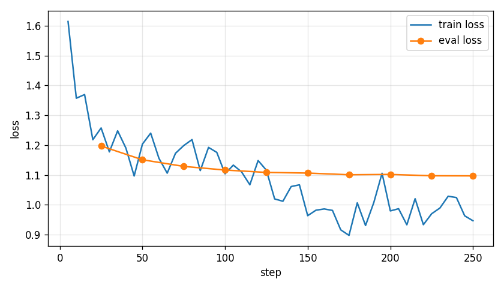

# DialogSum: LoRA-дообучение маленькой LLM для суммаризации диалогов

Задача: улучшить абстрактивную суммаризацию диалогов ([DialogSum](https://www.kaggle.com/datasets/marawanxmamdouh/dialogsum)) с помощью LoRA-дообучения небольшой decoder-only модели. Сравниваем:

1. **Бейзлайн без ML**: первое + последнее предложение диалога.
2. **Qwen2.5-0.5B-Instruct zero-shot**: инференс через **vLLM**.
3. **Qwen2.5-0.5B-Instruct + LoRA**: обучение через **unsloth + trl `SFTTrainer`** на 2 000 примеров, локальные JSON-логи и график loss, инференс смёрженной модели через vLLM. Поддержка W&B есть, в итоговом прогоне использовалось `report_to=none`.

Качество меряем по **ROUGE-1/2/L и BLEU** (multi-reference, в test по 3 референса на диалог) и через **LLM-as-judge** (`openai/gpt-oss-120b` на Groq). Отдельно смотрим примеры глазами.

## Данные и выводы EDA

Ноутбук: [`notebooks/exploratory/eda.ipynb`](notebooks/exploratory/eda.ipynb).

| split | диалогов | референсов на диалог |
|---|---:|---:|
| train | 12 460 | 1 |
| validation | 500 | 1 |
| test | 500 | 3 |

- Диалоги короткие: ~130 слов, ~9–10 реплик, почти всегда 2 спикера (`#Person1#`, `#Person2#`).
- Саммари ~20 слов, это ~15–18% длины диалога. Задача сильно абстрактивная.
- ~85–90% референсов используют теги `#Person1#`/`#Person2#` и пишутся от третьего лица. Эти требования включены в общий промпт zero-shot и LoRA; дообучение дополнительно адаптирует стиль и длину ответа.
- В токенах Qwen: диалог p99 ≈ 540, саммари p99 ≈ 85. Отсюда `max_seq_length=1024`, `max_new_tokens=128`, `max_model_len=2048`.
- Референсы расходятся между собой: leave-one-out ROUGE-L = 51.84, ROUGE-2 = 34.11. Это показатель согласованности аннотаций, а не верхняя граница качества модели. Одних n-граммных метрик мало.

## Результаты

Test: 500 диалогов, 3 референса. GPU: Colab T4.

| система | ROUGE-1 | ROUGE-2 | ROUGE-L | BLEU | длина, слов | скорость, примеров/с |
|---|---:|---:|---:|---:|---:|---:|
| lead: первое + последнее предложение | 28.22 | 7.11 | 23.96 | 11.65 | 15.89 | 8197.15 (CPU) |
| Qwen2.5-0.5B-Instruct zero-shot (vLLM) | 36.25 | 14.51 | 28.26 | 12.66 | 47.38 | 34.90 (T4) |
| Qwen2.5-0.5B-Instruct + LoRA (vLLM) | 51.48 | 25.54 | 42.77 | 29.89 | 22.81 | 41.91 (T4) |

Полная таблица: [`results/metrics.csv`](results/metrics.csv). Метрики пересчитаны локально по всем 500 предсказаниям каждой системы и совпали с Colab. ROUGE — средний F1 в шкале 0–100 с лучшим из трёх референсов для каждого вида ROUGE; BLEU — корпусный multi-reference sacreBLEU в шкале 0–100. Настройки: greedy decoding, `max_new_tokens=128`, один и тот же промпт, одинаковые 500 входов.

Скорость — пропускная способность одного пакетного вызова генерации; загрузка модели и подготовка промптов не включены. Zero-shot: 14.33 с, LoRA: 11.93 с. Прогрев и несколько повторов не выполнялись, токены/с и задержка одиночного запроса не измерялись. У LoRA ответы вдвое короче, поэтому прирост примеров/с не доказывает ускорение генерации одного токена. Бейзлайн выполняется на CPU, LLM — на T4.

LLM-as-judge (`openai/gpt-oss-120b`, 150 случайных диалогов из test, шкала 1–5):

| система | faithfulness | coverage | conciseness | fluency | overall | win rate |
|---|---:|---:|---:|---:|---:|---:|
| lead: первое + последнее | 3.19 | 1.48 | 4.68 | 4.77 | 2.23 | 22% |
| Qwen zero-shot | 2.95 | 3.05 | 3.69 | 4.67 | 2.95 | 57% |
| Qwen + LoRA | 3.20 | 2.42 | 4.32 | 4.83 | 2.89 | 57% |

Все 150 диалогов оценены для каждой системы. Основной прогон использовал 139 903 токена; отдельный предварительный debug-прогон на трёх диалогах не входит в итоговую таблицу. Таблицы: [`judge_scores.csv`](results/judge/judge_scores.csv), [`judge_per_example.csv`](results/judge/judge_per_example.csv). Сводка обучения и парных сравнений: [`run_summary.json`](results/run_summary.json).

В паре zero-shot / LoRA: **57 побед zero-shot, 56 побед LoRA, 37 ничьих**. Разность средних overall (zero-shot минус LoRA) = **0.06**, 95%-й paired-bootstrap интервал **[−0.18; 0.30]** включает ноль. Уверенного преимущества по общей оценке судьи не получено. LoRA выше по faithfulness и conciseness, но ниже по coverage; рост BLEU/ROUGE не привёл к росту overall у выбранного судьи. Обе LLM выше lead по среднему overall: разности относительно lead 0.72 (zero-shot) и 0.66 (LoRA), соответствующие интервалы [0.52; 0.92] и [0.46; 0.86].

`win rate` — доля диалогов, где система получила максимальный overall среди трёх; при ничьей победа засчитывается каждой системе, поэтому сумма долей может быть больше 100%. Отдельно сохраняются парные победы/ничьи и 95%-й paired-bootstrap интервал разности средних overall (10 000 перевыборок диалогов, seed 42). Такой интервал описывает вариацию по этой выборке диалогов при фиксированных ответах судьи, а не разброс между обучениями или разными судьями. Оценки одного LLM-судьи субъективны; повторная оценка и согласованность с человеческими аннотаторами не измерялись.

Обучение LoRA: **292.80 с** на Tesla T4, 2 эпохи, 250 шагов, 2 000 train / 200 validation, seed 42. Первый/последний залогированный train loss: **1.6141 → 0.9467**, eval loss: **1.1970 → 1.0970**; средний train loss за весь запуск — 1.0940. Последний eval loss также минимальный среди сохранённых точек. Это подтверждает обучение, но не является измерением factual consistency. Сводка: [`train_summary.json`](results/training/train_summary.json). Полная история `results/training/log_history.json` сохраняется локально после импорта архива и исключена из Git.



## Выбор модели и судьи

**[Qwen2.5-0.5B-Instruct](https://huggingface.co/Qwen/Qwen2.5-0.5B-Instruct)**:
- меньше 1B параметров (0.5B): в выполненном эксперименте обучение заняло около 4.9 минуты на T4; измеренная скорость vLLM — 34.90–41.91 примера/с;
- instruct-версия: сразу понимает задачу из промпта, так что zero-shot бейзлайн осмысленный и сравнение «до/после LoRA» честное;
- первоклассная поддержка в vLLM и unsloth, chat template с явными маркерами `<|im_start|>assistant`, что удобно для лосса только по ответу;
- контекст 32k, хотя нам хватает 2k.

**Судья `openai/gpt-oss-120b` (Groq)**:
- крупная reasoning-модель, доступная через выбранный API; доступ проверен реальными запросами. [Модели Groq](https://console.groq.com/docs/models), [лимиты](https://console.groq.com/docs/rate-limits);
- другое семейство относительно Qwen снижает риск предпочтения ответов своей модели, однако не устраняет смещения и ошибки судьи. Сравнительный бенчмарк самих судей не проводился;
- `reasoning_effort: low`, JSON-ответы, проверка всех критериев и диапазона целых баллов 1–5. Темп 8 запросов/мин выбран с учётом бесплатных токенных квот, максимум три попытки на запрос; при исчерпании попыток запуск останавливается с сохранением прогресса.

Как устроена оценка: судья видит диалог и **все три саммари в одном запросе** под метками A/B/C в **случайном порядке** (против позиционного bias и ради экономии лимитов). Каждое саммари оценивается по шкале 1–5 по критериям faithfulness, coverage, conciseness, fluency и overall, ответ приходит в JSON. Референс судье не показываем: оценка идёт относительно самого диалога. Ответы кешируются в `results/judge/judge_raw.jsonl`, поэтому прерванный запуск продолжается с места остановки.

Использованные руководства: [TRL SFTTrainer](https://huggingface.co/docs/trl/sft_trainer), [Unsloth fine-tuning guide](https://unsloth.ai/docs/get-started/fine-tuning-llms-guide). В GPU-бэкенде loss считается по ответу ассистента через `train_on_responses_only`; LoRA rank 16, alpha 16, dropout 0, attention- и MLP-проекции, learning rate 2e-4, две эпохи. Полный конфиг выполненного эксперимента сохранён в `results/run_configs/train_lora.yaml`.

## Выводы

LoRA повысила ROUGE-L на **14.51 п.п.**, ROUGE-2 на **11.03 п.п.**, BLEU на **17.23 пункта** относительно zero-shot. Средний ответ сократился с 47.38 до 22.81 слова, приблизившись к стилю референсов. Это результат одного запуска с фиксированным seed, без подбора гиперпараметров.

Судья подтвердил улучшение краткости и более высокий средний faithfulness у LoRA, но оценил её полноту ниже. Общий балл не улучшился: 2.89 против 2.95, разница неустойчива на исследованной выборке. Сокращение ответов может объяснять часть потери coverage, однако отдельная проверка причин этого эффекта не проводилась. Поэтому вывод эксперимента — успешная адаптация стиля и n-граммных метрик, при сохраняющихся фактических ошибках и компромиссе между краткостью и полнотой.

Ручной разбор показал как удачные ответы, так и пропуски ключевых фактов, перестановки участников и выдуманные детали. У `test_100` обнаружено противоречие всех трёх эталонов исходному диалогу. Примеры и комментарии: [`results/manual_review.md`](results/manual_review.md). Само улучшение ROUGE/BLEU не означает, что ответы всегда фактически верны.

### Какая модель лучшая по качеству и скорости?

По всем измеренным BLEU/ROUGE лучшая — **Qwen2.5-0.5B-Instruct + LoRA**. Среди двух LLM у неё выше и наблюдаемая пропускная способность: **41.91 против 34.90 примера/с** (примерно +20%). Вывод о скорости ограничен одним пакетным замером и разницей длин ответов. Бейзлайн «первое + последнее» быстрее вычислительно, но заметно уступает в покрытии содержания и n-граммных метриках.

По общей оценке judge однозначного победителя среди двух LLM нет: небольшой перевес среднего у zero-shot находится внутри неопределённости парного сравнения. Для кратких ответов в стиле DialogSum предпочтительна LoRA, но для применения с требованием полноты и строгой фактической точности ни одна из проверенных моделей пока не даёт надёжного качества без дополнительной проверки.

### Как ещё можно улучшить результаты?

- Проверить качество разметки и соответствие участников; ошибочные эталоны и дубли в train мешают обучению и оценке.
- Обучить на большей части train, выбирать чекпоинт по validation; test не использовать для выбора гиперпараметров и промпта.
- На validation сравнить более короткий промпт, few-shot примеры и явное требование сохранять роли и причинно-следственные связи. Текущий промпт перечисляет только двух участников, хотя в EDA найдены диалоги с большим числом спикеров.
- Проверить decoder-only instruct-модель 0.6–0.8B, сохранив ограничение задания <1B, одинаковые данные и протокол оценки.
- Добавить проверку фактов и ролей, человеческую разметку случайной выборки и второго независимого судью. Для оценки скорости — повторные прогоны, прогрев, токены/с и задержка на запрос при фиксированном размере батча.

## Структура репозитория

```
configs/
  data.yaml              # seed, пути, размер train/val подвыборки
  infer_zeroshot.yaml    # vLLM: модель, dtype, max_model_len, sampling
  infer_lora.yaml        # то же для смёрженной LoRA-модели
  train_lora.yaml        # LoRA r/alpha/modules, гиперпараметры SFT, wandb
  judge.yaml             # Groq endpoint, модель-судья, rpm, n_samples
notebooks/
  exploratory/eda.ipynb             # EDA
  experiments/colab_pipeline.ipynb  # запуск всего GPU-пайплайна в Colab
scripts/
  prepare_data.py   # raw CSV -> data/processed/{train,val,test}.jsonl
  baseline_lead.py  # первое + последнее предложение
  infer.py          # генерация через vLLM (или HF для отладки на CPU)
  train_lora.py     # LoRA SFT: unsloth (GPU) или чистые trl+peft
  evaluate.py       # ROUGE/BLEU по всем предсказаниям -> таблица
  judge.py          # LLM-as-judge через Groq
  import_colab_results.py  # проверка и перенос распакованного архива Colab
  summarize_run.py   # сводка loss и парные сравнения judge с bootstrap CI
src/dialogsum/
  data.py           # загрузка, группировка референсов, промпт
  metrics.py        # multi-reference ROUGE + sacreBLEU
  utils.py          # конфиги, seed, jsonl
results/            # таблицы метрик, оценки судьи, графики (коммитятся)
```

Данные (`data/`), веса и предсказания (`outputs/`), `.env`, сырые train-логи и кеш ответов судьи в Git не попадают. В репозитории сохраняются итоговые таблицы, график loss, ручной разбор, конфиги и сведения об окружении.

## Как запустить

### Окружение

```bash
python -m venv .venv
source .venv/bin/activate          # Windows: .venv\Scripts\activate
pip install -r requirements.txt    # CPU: EDA, бейзлайн, метрики, судья
pip install -e .
# GPU (Linux/Colab): pip install unsloth vllm && pip install -r requirements-gpu.txt
cp .env.example .env               # вписать GROQ_API_KEY
```

Данные скачиваются автоматически через `kagglehub` при первом запуске `prepare_data.py`. Можно положить CSV вручную в `data/raw/`.

### Пайплайн

```bash
python scripts/prepare_data.py --config configs/data.yaml
python scripts/baseline_lead.py
python scripts/infer.py --config configs/infer_zeroshot.yaml          # GPU, vLLM
python scripts/train_lora.py --config configs/train_lora.yaml         # GPU, unsloth
python scripts/infer.py --config configs/infer_lora.yaml              # GPU, vLLM
python scripts/evaluate.py
python scripts/judge.py --config configs/judge.yaml
```

Если GPU-часть выполнена отдельно в Colab, локально достаточно импортировать распакованный архив, оценить предсказания и запустить судью (без загрузки языковых моделей):

```bash
python scripts/import_colab_results.py --source /path/to/colab_results
python scripts/evaluate.py
python scripts/judge.py --config configs/judge.yaml
python scripts/summarize_run.py
```

`GROQ_API_KEY` берётся из локального `.env`. Скрипт импорта проверяет все 500 ID, непустые ответы каждой системы и наличие артефактов; хеши сохраняются в `results/artifact_manifest.json`. Исходные test-данные и полные предсказания остаются в игнорируемых `data/` и `outputs/`. Версии реально выполненного GPU-окружения — в [`results/environment.txt`](results/environment.txt), конфиги запуска — в [`results/run_configs/`](results/run_configs/), исходный коммит — в [`results/run_manifest.json`](results/run_manifest.json). Это снимок окружения Colab, а не универсальный requirements-файл для Windows.

Отладка на CPU, на паре примеров и с бэкендами HF/peft вместо vLLM/unsloth:

```bash
python scripts/infer.py --backend hf --debug
python scripts/train_lora.py --backend peft --debug
python scripts/judge.py --debug
```

На GPU проще всего запустить [`notebooks/experiments/colab_pipeline.ipynb`](notebooks/experiments/colab_pipeline.ipynb) в Colab (T4): он клонирует репозиторий, ставит зависимости, вызывает те же скрипты и сохраняет всё на Google Drive.


## Run the PR branch in Colab

Open the [GPU notebook in Colab](https://colab.research.google.com/github/semenovfilipp/text-generation/blob/feature/lora-summarization/notebooks/experiments/colab_pipeline.ipynb).
No merge is needed: the notebook checks out `feature/lora-summarization`.

1. Select a T4 GPU and connect Google Drive.
2. Optionally add `WANDB_API_KEY` to Colab Secrets for W&B logging. Groq is evaluated locally after the GPU run; no `GROQ_API_KEY` or local `.env` is needed in Colab.
3. Execute cells sequentially. Stop at an error and resolve it before continuing.
4. Short debug inference and training runs precede the full runs. Debug predictions are excluded from the final metric table.
5. Predictions, metrics, weights and installed package versions persist in `MyDrive/text-generation/outputs`. The last cell saves and downloads `colab_results.zip` without weights; put it in the local project folder for Codex to run Groq judging and finish the analysis.
6. Codex will use the returned predictions for local Groq judging, review examples in `manual_review.json`, copy final metrics and the loss plot into the repository, and replace README `TBD` entries with measured conclusions.

Estimated Colab T4 times: setup 5-15 minutes, debug runs 2-5 minutes, main GPU stages 10-30 minutes, judge 8-20 minutes. Actual times depend on the environment and API quotas.
The GPU pipeline has been run on Tesla T4; tested versions are recorded in `results/environment.txt`. Local training and vLLM were not run. Compare speed on the same hardware with the same generation settings.
If predictions or judge settings change, move the old judge cache before restarting. The script rejects stale caches to avoid mixing experiments.
